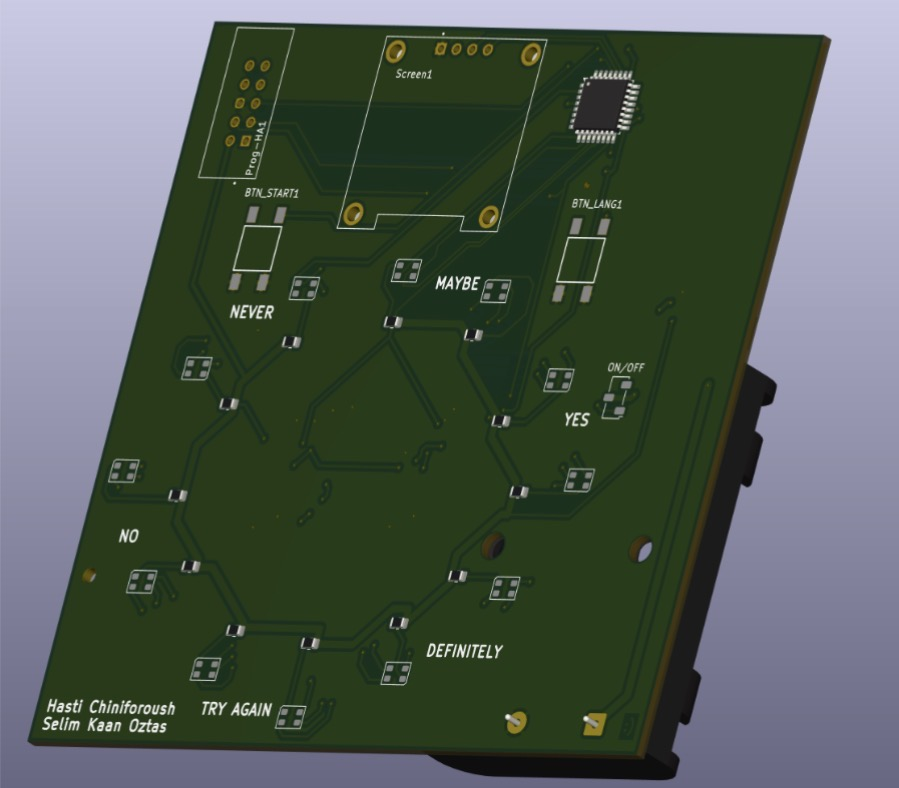
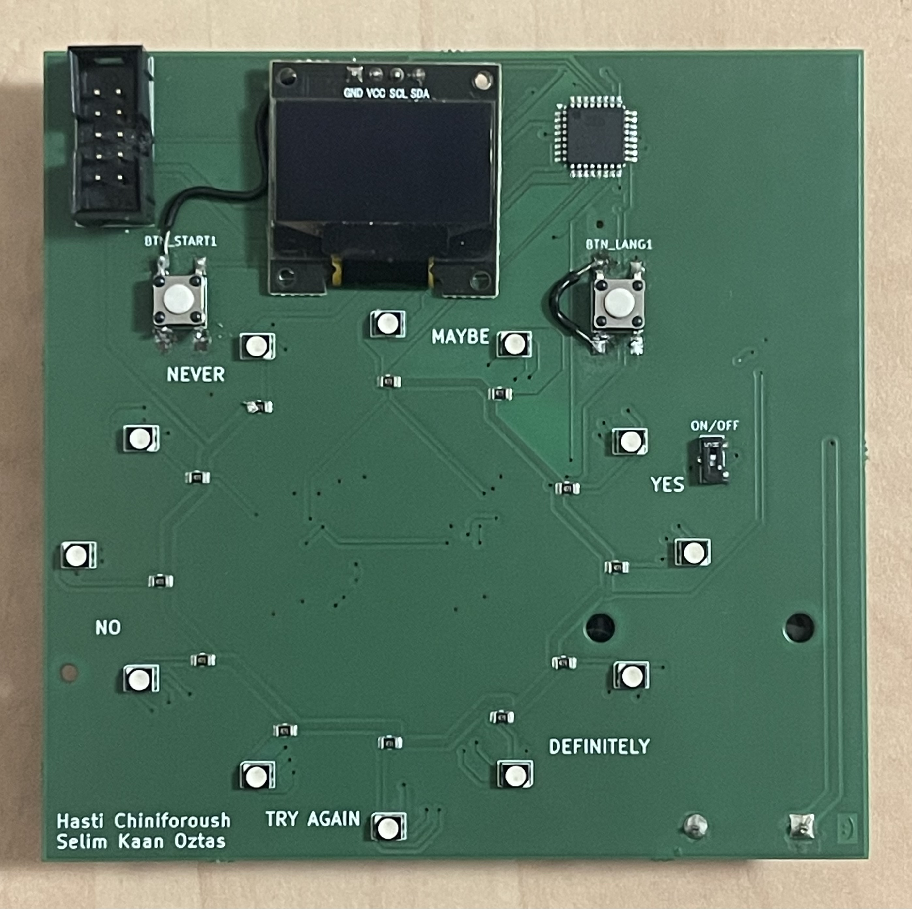
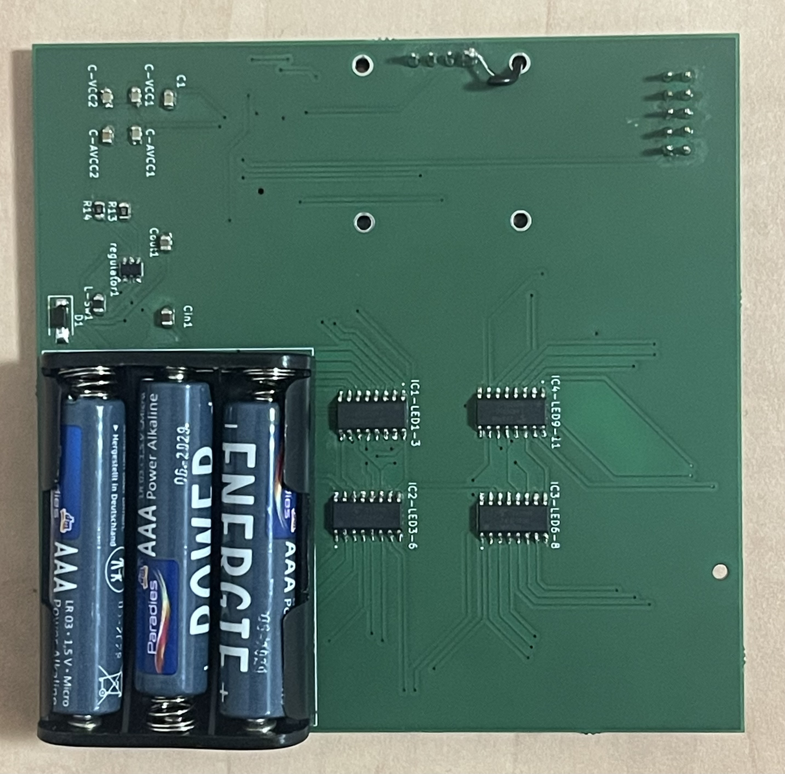
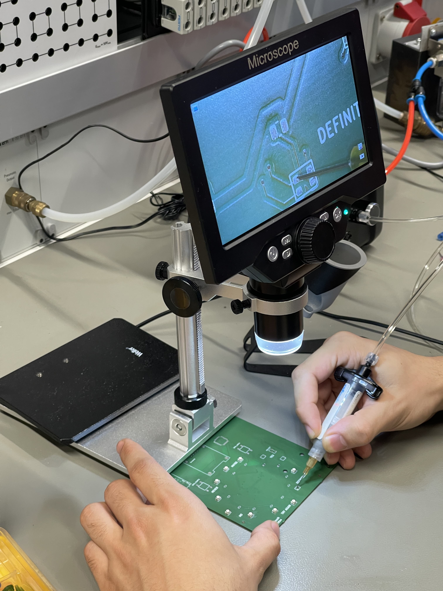
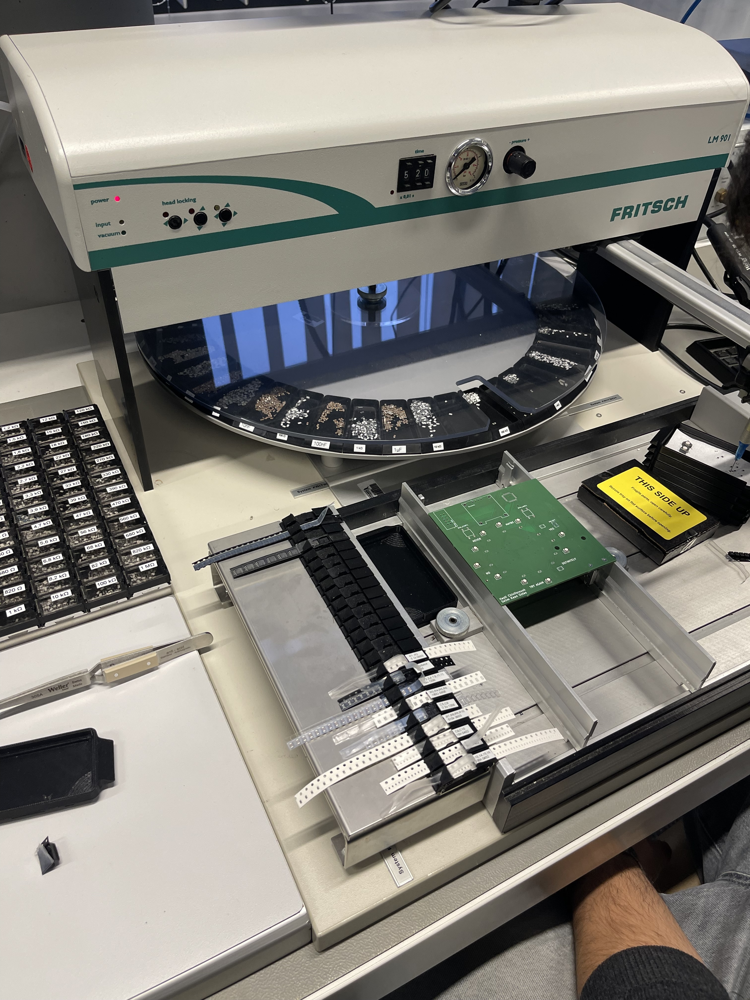
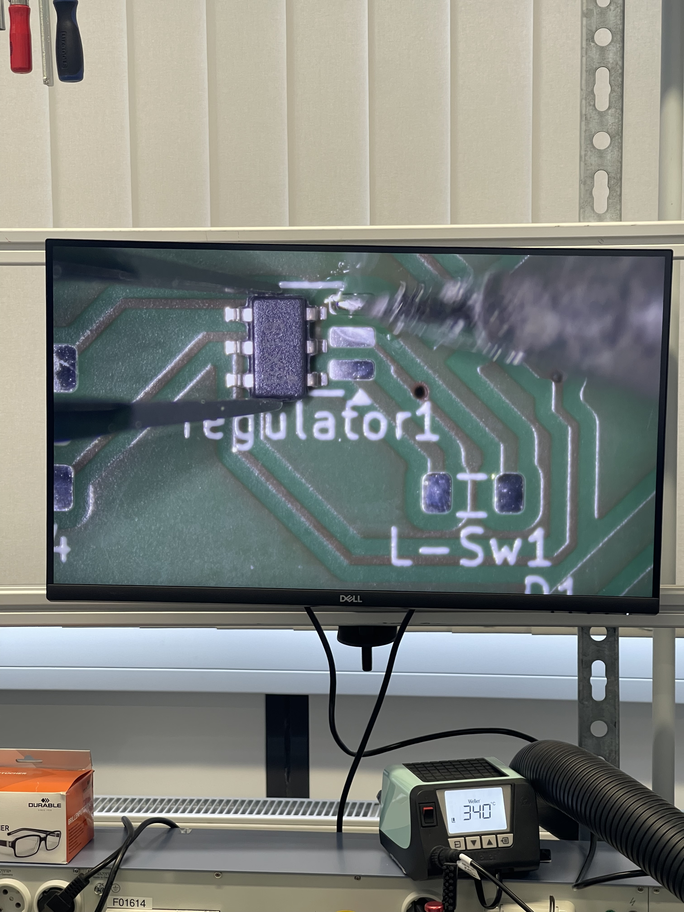
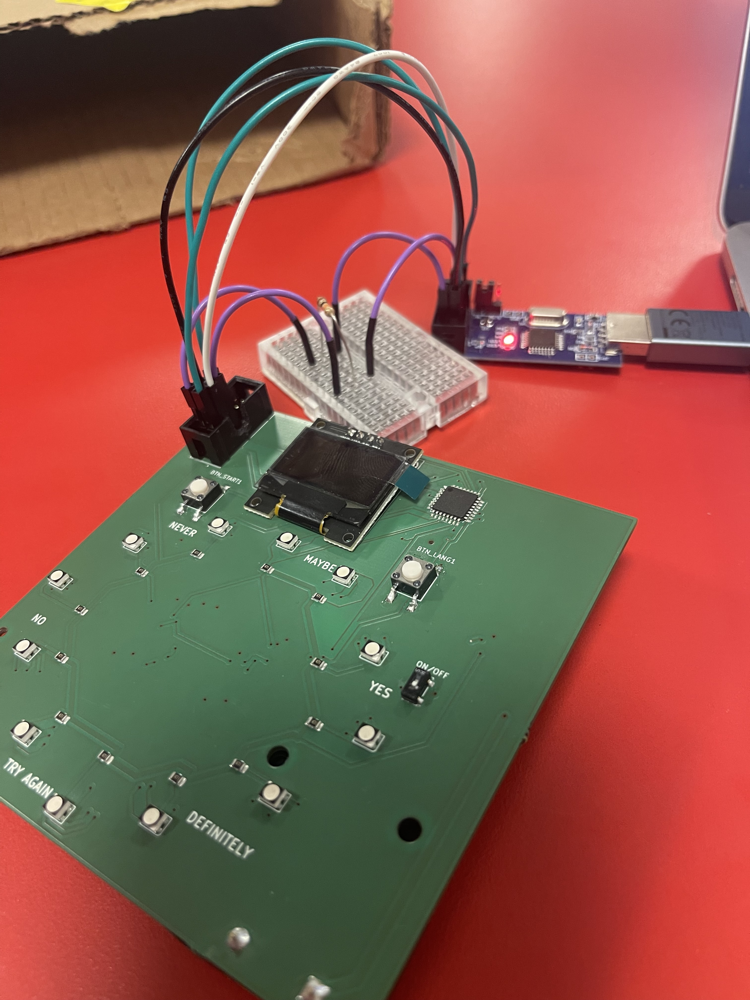
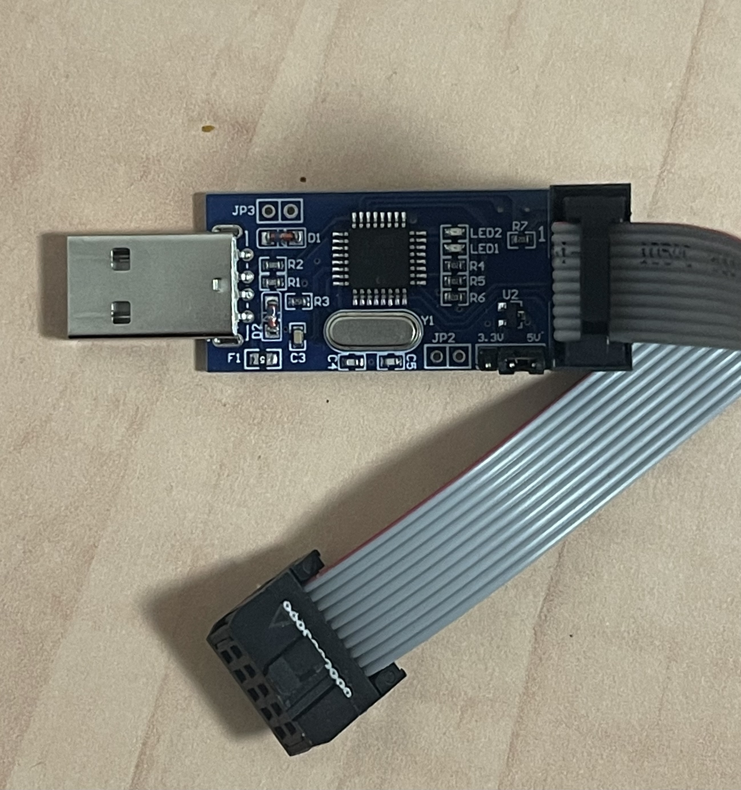

Embedded Decision-Maker | Custom PCB & AVR Firmware
A complete embedded hardware project: schematic design, PCB layout, manufacturing, assembly, C firmware, and system testing.

Project: Practical Electronics — Rhine-Waal University of Applied Sciences
Completed: January 2026
Platform: ATmega328P AVR microcontroller
Tools: Altium Designer, KiCad, AVR-GCC, USBasp, Aisler PCB fabrication
Project status: Functional hardware prototype. The core decision-selection function works; the originally planned OLED display was not operational in the final prototype.

Project overview
I developed the electronic hardware and firmware for a standalone, button-operated Decision-Maker that selects one option from a predefined set and displays the selection using an animated arrangement of 12 RGB LEDs. The project progressed from circuit design and component selection through PCB fabrication, soldering, microcontroller programming, and testing.

The device runs a fast LED-selection sequence when the user presses Start, gradually slows down, and stops at one selected LED position. Each pair of LEDs represents an option. A second button changes the available LED color modes.
Key features
- ATmega328P-based embedded control, programmed in C
- 12 RGB LEDs for animated visual feedback
- Two cascaded 74HC595 shift registers to expand the available digital outputs
- MCP1640 synchronous boost converter for power regulation
- Two-button user interface for starting a decision and changing LED modes
- Timer-based pseudo-random selection, driven by the timing of user interaction
- Custom PCB, finalized in KiCad and fabricated by Aisler
- Mixed automated and manual PCB assembly, followed by practical electrical testing
Hardware architecture
Subsystem	Implementation	Purpose
Controller	ATmega328P	Input handling, timing, LED control, and selection logic
Output	12 RGB LEDs	Indicate options and the selected result
Output expansion	2 × 74HC595	Control multiple LED outputs with fewer MCU pins
Power supply	MCP1640 boost converter	Regulate the supply for the control circuitry
User input	2 push buttons	Start selection and switch LED modes
Programming	USBasp / AVR toolchain	Flash and verify embedded C firmware

PCB design and fabrication
I initially developed the schematic and PCB design in Altium Designer, then finalized the project in KiCad. The PCB was manufactured by Aisler. I assembled the device using solder paste, pick-and-place/reflow techniques for selected SMD parts, and manual soldering for the remaining components. Solder joints were inspected under a microscope.
Firmware and control logic
The embedded firmware was written in C for the ATmega328P using the AVR toolchain. Its main functions are:
1. Initialize the system and LED outputs.
2. Monitor the Start and Mode push buttons.
3. On Start, cycle the active LED position rapidly and gradually reduce the cycling speed.
4. Sample timer-based state to select a final LED position.
5. Blink the selected result for approximately five seconds.
6. Allow the user to change the LED color mode.
The implemented modes on the final hardware included cyan, blue, green, and alternating blue–green. Software adjustments were also used to reduce excessive LED brightness.
Testing and results
- Successfully programmed and verified the microcontroller using a USBasp programmer.
- Verified startup behavior, button inputs, LED sequences, mode switching, and the final selection indication.
- Confirmed that repeated runs produced different selected positions.
- Measured approximately 4.32 V at the shift-register supply during testing.
- Completed and demonstrated a working LED-based Decision-Maker prototype.
Engineering challenges and lessons learned
Challenge	Response / outcome
Ordered RGB LED pinout differed from the assumed footprint	Adapted the firmware and color modes to use the available blue/green channels; red was not available in the final build
Push-button wiring did not produce the intended electrical behavior	Corrected the physical connections during assembly
Programming cable and PCB interface were incompatible	Used jumper wires and an external reset pull-up resistor to program the ATmega328P
OLED module remained non-functional despite measured power and I²C signal levels	Kept the core functionality operational using LED-based feedback instead of claiming a working display
LEDs were initially too bright	Reduced brightness through firmware changes

This project strengthened my experience in design-for-assembly, datasheet verification, hardware/software debugging, and adapting firmware to real PCB constraints.
My contributions
This was formally a two-person university project. I independently completed the technical development, including:
- Component selection and electronic schematic design
- PCB layout, design checks, and fabrication preparation
- PCB manufacturing coordination, soldering, and assembly
- Embedded C firmware implementation and programming
- Electrical measurements, troubleshooting, and hardware validation
My teammate supported project documentation and the presentation.
Project files
The following materials will be added as the repository is organized:
- hardware/ — schematic files, PCB layout, bill of materials, and selected manufacturing outputs
- firmware/ — original embedded C source code and build instructions
- images/ — photographs of the manufactured and assembled hardware
- docs/ — technical documentation and test notes
Files will be uploaded as they are reviewed. Not all materials are available in the repository yet.

Potential future improvements
- Redesign and validate the OLED interface for text-based output
- Recheck RGB LED package pinout and footprint to restore full-color output
- Provide a standardized in-circuit programming connector
- Improve power consumption and expand the decision options

## Project Gallery

### 1. PCB Design

3D visualization of the custom-designed PCB in KiCad.

### 2. Fabricated and Assembled PCB

Front side of the PCB:

Back side of the PCB:

### 3. PCB Manufacturing and Assembly

**Solder Paste Application**

**Automated Component Placement**

**Manual Soldering and Inspection**

### 4. Firmware Programming

Programming the ATmega328P microcontroller using a USBasp programmer.

**Programming Hardware**

## Project Files

### Hardware Design
- [Electronic Schematic (PDF)](hardware/Schematic-Design.pdf)
- [PCB Layout (PDF)](hardware/PCB-Design.pdf)

### Embedded Firmware
- [ATmega328P Firmware (C)](firmware/Decision-Maker.c)

### Project Documentation
The repository includes photographs of the PCB design,
manufacturing, assembly, and programming process.

Author / technical implementation: Hasti Chiniforoush
Institution: Rhine-Waal University of Applied Sciences, Germany
